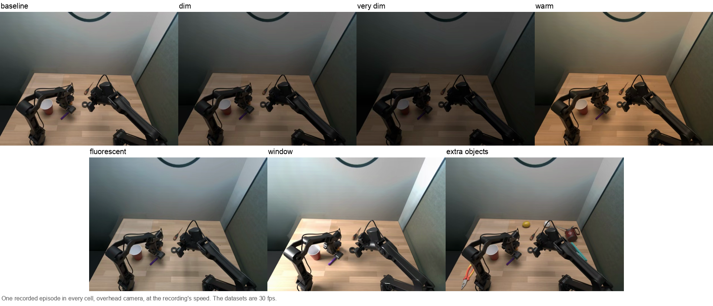
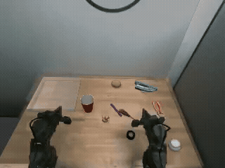
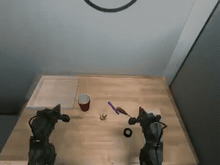
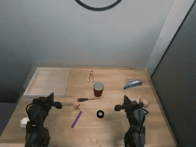

# Trossen bin picking, simulated: datasets, training and evaluation

Seven datasets that replay Trossen Robotics' public `bin_picking` recordings on a simulated copy of the station, each under a different condition: six kinds of light and one with extra objects on the table. In every episode a bimanual WidowX AI picks up one of five objects (red cup, yellow duck, purple marker, screwdriver, roll of black tape) and puts it in a clear tray. This report also covers ACT policies trained to pick up the cup and evaluated closed-loop on the simulated station: two trained on `baseline` alone and two on all seven datasets, for 30,000 and 90,000 steps each, and, for reference, one trained on the real recordings.

| | |
| --- | --- |
| Datasets | 7 looks, 92 episodes each, LeRobot v3.0 |
| Policies | ACT for the cup, trained on its 17 training episodes in `baseline` and on the same 17 in all seven datasets (119), for 30,000 and 90,000 steps each. For reference, one trained on the 18 real recordings for 30,000 steps. The four trained on the datasets used the earlier renders and are being trained again on the current ones |
| Placed of 20 on the held-out cup layouts: room light, low light, warm light, extra objects | Real recordings: 10, 8, 8 and 7. `baseline`: 5, 0, 0 and 7 at 30,000 steps, 8, 3, 5 and 10 at 90,000. All seven: 2, 0, 3 and 1 at 30,000 steps, 2, 3, 1 and 3 at 90,000 |
| By layout | Every placement is on the layout where the left arm picks the cup up. No policy placed it on the right arm's layout, the one trained on real recordings included |

## Datasets

Each episode follows one recording. The joint states, actions, timing and task text are the recording's, unchanged, and the four cameras are rendered from the real cameras' viewpoints. In 92 of the 99 recordings we could check, the object ends up where it did in the recording, in the tray or not. The datasets leave out the 7 that don't, plus source episode 66, which wasn't rendered, so each one has 92 episodes.

[Watch all seven playing together](docs/preview.mp4) on the overhead camera, and [the same episode from all four cameras](docs/cameras.mp4) in `baseline`.

On 22 November 2026 all seven were rendered again with a new desk and walls. The desk had been a photo stitched from the recording cameras, with the arms' shadows baked in, and the walls carried a strip of the real desk that looked like a second, lower desk behind the simulated one. The episodes, joint data and splits are unchanged.

| Dataset | What it changes | Episodes |
| --- | --- | --- |
| [`trossen-bin-picking-sim-baseline`](https://huggingface.co/datasets/kiteml/trossen-bin-picking-sim-baseline) | The reference look, lit to match the recordings. | 92 |
| [`trossen-bin-picking-sim-dim`](https://huggingface.co/datasets/kiteml/trossen-bin-picking-sim-dim) | The same lights at about 40%. | 92 |
| [`trossen-bin-picking-sim-very-dim`](https://huggingface.co/datasets/kiteml/trossen-bin-picking-sim-very-dim) | The same lights at about 15%. The darkest look in the set. | 92 |
| [`trossen-bin-picking-sim-warm`](https://huggingface.co/datasets/kiteml/trossen-bin-picking-sim-warm) | Warm, orange-tinted light, like old tungsten bulbs. | 92 |
| [`trossen-bin-picking-sim-fluorescent`](https://huggingface.co/datasets/kiteml/trossen-bin-picking-sim-fluorescent) | Cool, blue-white light from a long, narrow ceiling panel. | 92 |
| [`trossen-bin-picking-sim-window`](https://huggingface.co/datasets/kiteml/trossen-bin-picking-sim-window) | Daylight from a window beside the table, with the room lights low. Strong side light and shadows. | 92 |
| [`trossen-bin-picking-sim-extra-objects`](https://huggingface.co/datasets/kiteml/trossen-bin-picking-sim-extra-objects) | Room light, with three to five new objects on the table (stapler, pliers, lemon, baseball, oil can), placed clear of the arms' paths. | 92 |

The episodes, in the same order, cover 20 tape, 19 cup, 19 marker, 18 duck and 16 screwdriver recordings. In 42 of them one arm picks the object up and hands it to the other.

All seven are LeRobot v3.0 at 30 fps, with the same keys, robot type (`bi_widowxai_follower_robot`) and task text as the source, so code that reads the source reads these too.

| Key | Shape | Content |
| --- | --- | --- |
| `observation.images.camera_high` | 480 x 640 x 3, 30 fps, AV1 | Overhead camera |
| `observation.images.camera_low` | 480 x 640 x 3, 30 fps, AV1 | Low front camera |
| `observation.images.camera_left_wrist`, `observation.images.camera_right_wrist` | 480 x 640 x 3, 30 fps, AV1 | Wrist cameras |
| `observation.state` | 14 | Joint positions from the recording, left arm then right |
| `action` | 14 | Joint targets from the recording |

Training episodes come first, then 8 held-out test episodes (source episodes 4, 14, 27, 42, 60, 61, 90 and 96), and `splits` in `meta/info.json` gives the two ranges. `meta/provenance.json` lists each episode's source episode, object, whether it has a handover, and whether the object ended in the tray in the recording and in the replay.

## Training

The four policies trained on the datasets were trained and tested on the earlier renders, before the new desk. They are being trained again on the current datasets, with the same episodes, settings and tests, and this section and the next will be updated with the results.

ACT doesn't read the instruction, so each policy is trained for one object, the cup. From the four cameras and the 14 joint positions it outputs 14 joint targets, 100 steps at a time.

- Data: the 17 cup episodes of the training split. The `baseline` policies have them in `baseline` only (6,867 frames). The all-seven policies have the same 17 episodes in each of the seven datasets (119 episodes, 48,069 frames). The reference policy has the 18 real cup recordings outside the test split, as recorded (7,318 frames): the same 17 plus source episode 17, which the datasets leave out.
- Runs: batch 8 on one A100 each, with the same settings except the number of steps. 30,000 steps took about 78 minutes on the datasets and 1 hour 50 minutes on the real recordings; 90,000 steps took about 4 hours. So at the same number of steps an all-seven policy sees each episode a seventh as often as a `baseline` one. Over their runs the `baseline` policies went through their data about 35 and 105 times, the all-seven policies about 5 and 15 times, and the real-data policy about 33 times.
- Weights, each run's last checkpoint: [`kiteml/trossen-bin-picking-sim-act-cup-baseline`](https://huggingface.co/kiteml/trossen-bin-picking-sim-act-cup-baseline) and [`kiteml/trossen-bin-picking-sim-act-cup-baseline-90k`](https://huggingface.co/kiteml/trossen-bin-picking-sim-act-cup-baseline-90k), [`kiteml/trossen-bin-picking-sim-act-cup-all`](https://huggingface.co/kiteml/trossen-bin-picking-sim-act-cup-all) and [`kiteml/trossen-bin-picking-sim-act-cup-all-90k`](https://huggingface.co/kiteml/trossen-bin-picking-sim-act-cup-all-90k) (30,000 and 90,000 steps), and [`kiteml/trossen-bin-picking-act-cup-real`](https://huggingface.co/kiteml/trossen-bin-picking-act-cup-real). They load with LeRobot 0.6 or later.

## Evaluation

[Kite](https://kiteml.com) ran the policies closed-loop on the simulated station in MuJoCo, with the cup, the other objects and the tray as physical bodies.

- The two held-out cup episodes give the layouts: in source episode 4 the left arm picks the cup up, in source episode 14 the right arm does. Each test runs 10 times on each layout, with the cup starting within 1 cm of its recorded spot. Every policy gets the same 20 starts.
- A run counts as placed when the cup is lifted at least 3 cm and ends inside the tray. Each run lasts up to 19 s, and the policy carries out each 100-step plan in full.
- The camera images come from the simulator's own renderer, not from the renders in the datasets above, and the low camera shows a photo of the empty station with cut-outs of the real cup. So the policies trained on the datasets are tested on images that look different from the ones they learned from and closer to the real recordings, which suits the policy trained on those.
- The wrist-camera cables in the simulator follow the datasets' cables: each point of the datasets' curve is pinned to the arm link that carries it best, so the cables bend with the joints. They sit within 2 mm of the datasets' cables at the median and up to 7 cm off at the top of the loop over the wrist, which the datasets draw straight up in every frame.
- The tests: room light; low light, at 30 to 60%; warm light, at 2,700 to 3,500 K; and extra objects, where the lemon, baseball, stapler and pliers stand where `extra-objects` has them in those two episodes.

| Test | Real recordings, 30,000 steps | `baseline`, 30,000 steps | `baseline`, 90,000 steps | All seven, 30,000 steps | All seven, 90,000 steps |
| --- | --- | --- | --- | --- | --- |
| Room light | 10/20 (50%, 30–70%) | 5/20 (25%, 11–47%) | 8/20 (40%, 22–61%) | 2/20 (10%, 3–30%) | 2/20 (10%, 3–30%) |
| Low light | 8/20 (40%, 22–61%) | 0/20 (0%, 0–16%) | 3/20 (15%, 5–36%) | 0/20 (0%, 0–16%) | 3/20 (15%, 5–36%) |
| Warm light | 8/20 (40%, 22–61%) | 0/20 (0%, 0–16%) | 5/20 (25%, 11–47%) | 3/20 (15%, 5–36%) | 1/20 (5%, 1–24%) |
| Extra objects | 7/20 (35%, 18–57%) | 7/20 (35%, 18–57%) | 10/20 (50%, 30–70%) | 1/20 (5%, 1–24%) | 3/20 (15%, 5–36%) |
| All four | 33/80 | 12/80 | 26/80 | 6/80 | 9/80 |

The same starts, run by run: how many only the first policy placed / only the second.

| Test | Real recordings / `baseline` at 90,000 steps | `baseline`: 30,000 / 90,000 steps | `baseline` / all seven at 90,000 steps | `baseline` / all seven at 30,000 steps |
| --- | --- | --- | --- | --- |
| Room light | 2 / 0 | 1 / 4 (p = 0.38) | 6 / 0 (p = 0.03) | 5 / 2 (p = 0.45) |
| Low light | 6 / 1 (p = 0.13) | 0 / 3 (p = 0.25) | 3 / 3 | 0 / 0 |
| Warm light | 4 / 1 (p = 0.38) | 0 / 5 (p = 0.06) | 5 / 1 (p = 0.22) | 0 / 3 (p = 0.25) |
| Extra objects | 0 / 3 (p = 0.25) | 0 / 3 (p = 0.25) | 7 / 0 (p = 0.02) | 6 / 0 (p = 0.03) |
| All four | 12 / 5 (p = 0.14) | 1 / 15 (p < 0.001) | 21 / 4 (p < 0.001) | 11 / 5 (p = 0.21) |

The intervals are 95% Wilson intervals and the p-values exact McNemar tests on the runs only one of the two policies placed.

All 86 placements are on the left arm's layout. On the right arm's layout no policy placed the cup in any test, and 6 of its 200 runs lifted it, 5 of them by the real-data policy. Of the 314 misses, 268 never lifted the cup and 46 lifted it but it didn't end in the tray.

The policy trained on the real recordings placed the cup most often, 33 times in 80 runs, and changed light hurt it least: 8 of 20 in low light and in warm light, against 10 under room light. It is also the policy the test images favour, as explained above.

Of the policies trained on the datasets, `baseline` at 90,000 steps did best, 26 of 80. Under room light and with the extra objects it placed the cup about as often as the real-data policy (8 and 10 of 20, against 10 and 7), and in changed light less often (3 and 5, against 8 and 8). Training three times longer helped it in every test: on the same starts, the 90,000-step policy placed the cup 15 times where the 30,000-step one didn't, and the reverse happened once.

Training on all seven datasets did worse than `baseline` alone at both lengths, 6 and 9 of 80 against 12 and 26. It didn't do better in low or warm light either, though dim, very dim and warm light are among the looks it trained on. Two things may explain it, and we haven't separated them: at the same number of steps it sees each episode a seventh as often, and the lighting it learned from is the datasets' renders, while the tests use the simulator's own renderer.

The policies trained on the datasets also turned out to be sensitive to how the cables are drawn. An earlier version of this report tested on a simulator whose wrist-camera cables were fixed hooks, unlike the datasets'. With cables that follow the datasets', the real-data policy's results moved by at most one run per test (34 to 33 of 80 in all), while the 90,000-step all-seven policy's fell from 18 to 9, and from 8 to 2 under room light, and the 30,000-step `baseline` policy's from 18 to 12. That version also concluded that training longer closed the gap between all seven and `baseline`. With the cables fixed and `baseline` also trained for 90,000 steps, it doesn't.

The same start under room light, and another with the extra objects, for the two 90,000-step policies trained on the datasets:

| | |
| :---: | :---: |
|  |  |
| Trained on `baseline`, room light: placed | Trained on all seven, room light: lifted, not in the tray |
|  |  |
| Trained on `baseline`, extra objects: placed | Trained on all seven, extra objects: never lifts the cup |

The policy trained on the real recordings:

| | |
| :---: | :---: |
|  |  |
| Room light: placed | The right arm's layout, extra objects: the right arm lifts the cup but doesn't bring it to the tray. No policy placed the cup on this layout |

All the numbers in this section, run by run, are in [`policy/results/SUMMARY.md`](policy/results/SUMMARY.md) and [`policy/results/summary.json`](policy/results/summary.json).

## Limits

- Only the arms and the object being picked up move in the datasets. The other objects stay where they start, so an object the real arm bumps or knocks over stays put here. About 1 in 20 of those objects may start somewhere other than where it was in the recording.
- In the datasets, the gripper's fingers close until they touch the object. The object is then held rigidly until it's let go, and falls under simulated physics, so how it settles in the tray can differ from the recording.
- In about 3 in 100 frames where an object is held, a finger sinks more than 3 mm into it, most often into the roll of tape.
- The cables bend with the arms but don't swing.
- Two of the recordings (source episodes 69 and 74) are failed attempts, and they stay failed here. `in_tray_recorded` in `meta/provenance.json` marks them.
- The policies were tested on two layouts, 20 runs per test, so the intervals are wide. They are cup-only and were trained on 17 or 18 recordings.
- The evaluation simulates grasping with real contacts, which is harder than the datasets' rigid holds: replaying the recorded motions on it puts the object in the tray in 57 of 100 episodes.
- Simulation only. Nothing here has been tested on a real robot.

## Credits

Derived from Trossen Robotics' public `bin_picking` dataset (s3://trossen-public-datasets-977e8d43bcff/bin_picking/), released under Apache-2.0. These datasets keep that license. The extra objects are [Poly Haven](https://polyhaven.com) scans (CC0). The policies are [LeRobot](https://github.com/huggingface/lerobot)'s ACT (Apache-2.0). Made by [Kite](https://kiteml.com).
