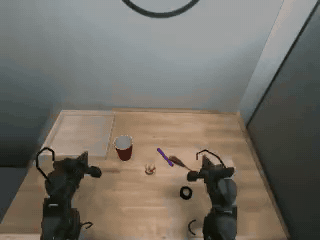
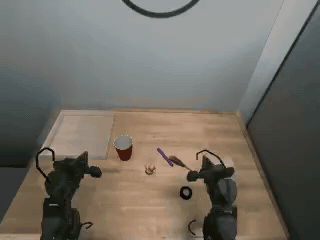
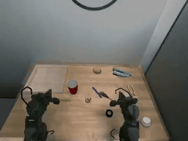
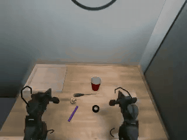
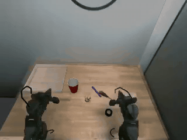

# Trossen bin picking, simulated: datasets, training and evaluation

Seven datasets that replay Trossen Robotics' public `bin_picking` recordings on a simulated copy of the station, each under a different condition: six kinds of light and one with extra objects on the table. In every episode a bimanual WidowX AI picks up one of five objects (red cup, yellow duck, purple marker, screwdriver, roll of black tape) and puts it in a clear tray. This report also covers three ACT policies trained to pick up the cup, evaluated closed-loop on the simulated station: one trained on `baseline` alone, and two on all seven datasets, one trained three times as long as the other.

| | |
| --- | --- |
| Datasets | 7 looks, 92 episodes each, LeRobot v3.0 |
| Policies | ACT for the cup: one trained on its 17 training episodes in `baseline` for 30,000 steps, two on the same 17 in all seven datasets (119), for 30,000 and 90,000 steps |
| Held-out cup layouts, room light | 8 of 20 placed (`baseline`), against 2 of 20 (all seven, 30,000 steps) and 8 of 20 (all seven, 90,000 steps) |
| Low light and warm light | 2 and 0 of 20, against 2 and 1, and 3 and 4 |
| Extra objects on the table | 8 of 20, against 0 and 3 |
| By layout | Every placement is on the layout where the left arm picks the cup up. No policy placed it on the right arm's layout |

## Datasets

Each episode follows one recording. The joint states, actions, timing and task text are the recording's, unchanged, and the four cameras are rendered from the real cameras' viewpoints. In 92 of the 99 recordings we could check, the object ends up where it did in the recording, in the tray or not. The datasets leave out the 7 that don't, plus source episode 66, which wasn't rendered, so each one has 92 episodes.

[Watch all seven playing together](docs/preview.mp4) on the overhead camera, and [the same episode from all four cameras](docs/cameras.mp4) in `baseline`.

| Dataset | What it changes | Episodes |
| --- | --- | --- |
| [`trossen-bin-picking-sim-baseline`](https://huggingface.co/datasets/kiteml/trossen-bin-picking-sim-baseline) | The reference look, lit to match the recordings. | 92 |
| [`trossen-bin-picking-sim-dim`](https://huggingface.co/datasets/kiteml/trossen-bin-picking-sim-dim) | The same lights at about 40%. | 92 |
| [`trossen-bin-picking-sim-very-dim`](https://huggingface.co/datasets/kiteml/trossen-bin-picking-sim-very-dim) | The same lights at about 15%. The darkest look in the set. | 92 |
| [`trossen-bin-picking-sim-warm`](https://huggingface.co/datasets/kiteml/trossen-bin-picking-sim-warm) | Warm, orange-tinted light, like old tungsten bulbs. | 92 |
| [`trossen-bin-picking-sim-fluorescent`](https://huggingface.co/datasets/kiteml/trossen-bin-picking-sim-fluorescent) | Cool, blue-white light from a long, narrow ceiling panel. | 92 |
| [`trossen-bin-picking-sim-window`](https://huggingface.co/datasets/kiteml/trossen-bin-picking-sim-window) | Daylight from a window beside the table, with the room lights low. Strong side light and shadows. | 92 |
| [`trossen-bin-picking-sim-extra-objects`](https://huggingface.co/datasets/kiteml/trossen-bin-picking-sim-extra-objects) | Room light, with three to five new objects on the table (stapler, pliers, lemon, baseball, oil can), placed clear of the arms' paths. | 92 |

The episodes, in the same order, cover 20 tape, 19 cup, 19 marker, 18 duck and 16 screwdriver recordings. In 42 of them one arm picks the object up and hands it to the other.

All seven are LeRobot v3.0 at 30 fps, with the same keys, robot type (`bi_widowxai_follower_robot`) and task text as the source, so code that reads the source reads these too.

| Key | Shape | Content |
| --- | --- | --- |
| `observation.images.camera_high` | 480 x 640 x 3, 30 fps, AV1 | Overhead camera |
| `observation.images.camera_low` | 480 x 640 x 3, 30 fps, AV1 | Low front camera |
| `observation.images.camera_left_wrist`, `observation.images.camera_right_wrist` | 480 x 640 x 3, 30 fps, AV1 | Wrist cameras |
| `observation.state` | 14 | Joint positions from the recording, left arm then right |
| `action` | 14 | Joint targets from the recording |

Training episodes come first, then 8 held-out test episodes (source episodes 4, 14, 27, 42, 60, 61, 90 and 96), and `splits` in `meta/info.json` gives the two ranges. `meta/provenance.json` lists each episode's source episode, object, whether it has a handover, and whether the object ended in the tray in the recording and in the replay.

## Training

ACT doesn't read the instruction, so each policy is trained for one object, the cup. From the four cameras and the 14 joint positions it outputs 14 joint targets, 100 steps at a time.

- Data: the 17 cup episodes of the training split. The `baseline` policy has them in `baseline` only (6,867 frames). The all-seven policies have the same 17 episodes in each of the seven datasets (119 episodes, 48,069 frames).
- Runs: batch 8 on one A100 each, with the same settings except the number of steps. The `baseline` policy and the first all-seven policy trained for 30,000 steps, about 78 minutes each, so the all-seven one saw each episode a seventh as often. The second all-seven policy trained for 90,000 steps, about 4 hours. Over its run the `baseline` policy went through its data about 35 times, the 30,000-step all-seven policy about 5 times and the 90,000-step one about 15 times.
- Weights: [`kiteml/trossen-bin-picking-sim-act-cup-baseline`](https://huggingface.co/kiteml/trossen-bin-picking-sim-act-cup-baseline), [`kiteml/trossen-bin-picking-sim-act-cup-all`](https://huggingface.co/kiteml/trossen-bin-picking-sim-act-cup-all) (30,000 steps) and [`kiteml/trossen-bin-picking-sim-act-cup-all-90k`](https://huggingface.co/kiteml/trossen-bin-picking-sim-act-cup-all-90k) (90,000 steps), each run's last checkpoint. They load with LeRobot 0.6 or later.

## Evaluation

[Kite](https://kiteml.com) ran the policies closed-loop on the simulated station in MuJoCo, with the cup, the other objects and the tray as physical bodies.

- The two held-out cup episodes give the layouts: in source episode 4 the left arm picks the cup up, in source episode 14 the right arm does. Each test runs 10 times on each layout, with the cup starting within 1 cm of its recorded spot. Every policy gets the same 20 starts.
- A run counts as placed when the cup is lifted at least 3 cm and ends inside the tray. Each run lasts up to 19 s, and the policy carries out each 100-step plan in full.
- The camera images come from the simulator's own renderer (the low camera over a photo of the empty station), which looks simpler than the datasets above.
- The tests: room light; low light, at 30 to 60%; warm light, at 2,700 to 3,500 K; and extra objects, where the lemon, baseball, stapler and pliers stand where `extra-objects` has them in those two episodes.

| Test | Trained on `baseline`, 30,000 steps | Trained on all seven, 30,000 steps | Trained on all seven, 90,000 steps |
| --- | --- | --- | --- |
| Room light | 8/20 (40%, 22–61%) | 2/20 (10%, 3–30%) | 8/20 (40%, 22–61%) |
| Low light | 2/20 (10%, 3–30%) | 2/20 (10%, 3–30%) | 3/20 (15%, 5–36%) |
| Warm light | 0/20 (0%, 0–16%) | 1/20 (5%, 1–24%) | 4/20 (20%, 8–42%) |
| Extra objects | 8/20 (40%, 22–61%) | 0/20 (0%, 0–16%) | 3/20 (15%, 5–36%) |

The same starts, run by run: how many only the first policy placed / only the second.

| Test | `baseline` / all seven at 30,000 steps | `baseline` / all seven at 90,000 steps | All seven: 30,000 / 90,000 steps |
| --- | --- | --- | --- |
| Room light | 6 / 0 (p = 0.03) | 2 / 2 | 0 / 6 (p = 0.03) |
| Low light | 1 / 1 | 2 / 3 | 2 / 3 |
| Warm light | 0 / 1 | 0 / 4 (p = 0.13) | 1 / 4 (p = 0.38) |
| Extra objects | 8 / 0 (p = 0.008) | 5 / 0 (p = 0.06) | 0 / 3 (p = 0.25) |

The intervals are 95% Wilson intervals and the p-values exact McNemar tests on the runs only one of the two policies placed.

All 41 placements are on the left arm's layout. On the right arm's layout no policy lifted the cup in any test. Of the 199 misses, 167 never lifted the cup and 32 lifted it but it didn't end in the tray.

At 30,000 steps, training on all seven datasets did worse than training on `baseline` alone: under room light and with extra objects the `baseline` policy placed the cup more often on the same starts. Much of that gap came from training too little. Trained for 90,000 steps, the all-seven policy places the cup as often as the `baseline` one under room light (8 of 20 each), and more often in warm light (4 against 0) and low light (3 against 2), though with 20 runs those two differences could be chance. In changed light it also lifts the cup more often: on the left arm's layout, 8 of 10 times in warm light and 8 in low light, against 0 and 3. With the extra objects it still places the cup less often (3 against 8). The comparison is now uneven the other way, since the 90,000-step policy trained three times as long as the `baseline` one, which we haven't trained beyond 30,000 steps.

The same start, under room light and with the extra objects, for the `baseline` policy and the 30,000-step all-seven one:

| | |
| :---: | :---: |
|  |  |
| Trained on `baseline`, room light: placed | Trained on all seven, room light: lifted, dropped beside the tray |
|  |  |
| Trained on `baseline`, extra objects: placed | Trained on all seven, extra objects: never lifts the cup |

| | |
| :---: | :---: |
|  |  |
| The right arm's layout: never lifted, by any policy, in every test | Trained on all seven (30,000 steps), room light: one of its two placements |

All the numbers in this section, run by run, are in [`policy/results/SUMMARY.md`](policy/results/SUMMARY.md) and [`policy/results/summary.json`](policy/results/summary.json).

## Limits

- Only the arms and the object being picked up move in the datasets. The other objects stay where they start, so an object the real arm bumps or knocks over stays put here. About 1 in 20 of those objects may start somewhere other than where it was in the recording.
- In the datasets, the gripper's fingers close until they touch the object. The object is then held rigidly until it's let go, and falls under simulated physics, so how it settles in the tray can differ from the recording.
- In about 3 in 100 frames where an object is held, a finger sinks more than 3 mm into it, most often into the roll of tape.
- In two renders the clear tray turns solid black for a moment: frames 139 to 166 of episode 75 in `warm` (source episode 89), and 3 frames between 223 and 282 of episode 83 in `fluorescent` (source episode 99).
- The cables bend with the arms but don't swing.
- Two of the recordings (source episodes 69 and 74) are failed attempts, and they stay failed here. `in_tray_recorded` in `meta/provenance.json` marks them.
- The policies were tested on two layouts, 20 runs per test, so the intervals are wide. They are cup-only and were trained on 17 recordings.
- The evaluation simulates grasping with real contacts, which is harder than the datasets' rigid holds: replaying the recorded motions on it puts the object in the tray in 57 of 100 episodes.
- Simulation only. Nothing here has been tested on a real robot.

## Credits

Derived from Trossen Robotics' public `bin_picking` dataset (s3://trossen-public-datasets-977e8d43bcff/bin_picking/), released under Apache-2.0. These datasets keep that license. The extra objects are [Poly Haven](https://polyhaven.com) scans (CC0). The policies are [LeRobot](https://github.com/huggingface/lerobot)'s ACT (Apache-2.0). Made by [Kite](https://kiteml.com).
