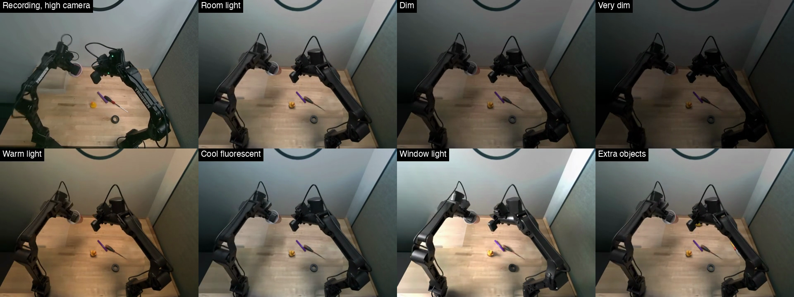

# Trossen bin picking, simulated

Seven datasets that replay Trossen Robotics' public `bin_picking` recordings on a simulated copy of the station, each under a different condition: six kinds of light and one with extra objects on the table. In every episode a bimanual WidowX AI picks up one of five objects (red cup, yellow duck, purple marker, screwdriver, roll of black tape) and puts it in a clear tray.

Each episode follows one recording. The joint states, actions, timing and task text are the recording's, unchanged, and the four cameras are rendered from the real cameras' viewpoints. In 92 of the 99 recordings we could check, the object ends up where it did in the recording, in the tray or not. The datasets leave out the 7 that don't, plus source episode 66, which wasn't rendered, so each one has 92 episodes.

The same episode from each camera, with the recording in the top-left tile: [overhead](docs/preview_camera_high.mp4), [low front](docs/preview_camera_low.mp4), [left wrist](docs/preview_camera_left_wrist.mp4) and [right wrist](docs/preview_camera_right_wrist.mp4). The preview tile called "Room light" is the `baseline` dataset.

## Datasets

| Dataset | What it changes | Episodes |
| --- | --- | --- |
| [`trossen-bin-picking-sim-baseline`](https://huggingface.co/datasets/kiteml/trossen-bin-picking-sim-baseline) | The reference look, lit to match the recordings. | 92 |
| [`trossen-bin-picking-sim-dim`](https://huggingface.co/datasets/kiteml/trossen-bin-picking-sim-dim) | The same lights at about 40%. | 92 |
| [`trossen-bin-picking-sim-very-dim`](https://huggingface.co/datasets/kiteml/trossen-bin-picking-sim-very-dim) | The same lights at about 15%. The darkest look in the set. | 92 |
| [`trossen-bin-picking-sim-warm`](https://huggingface.co/datasets/kiteml/trossen-bin-picking-sim-warm) | Warm, orange-tinted light, like old tungsten bulbs. | 92 |
| [`trossen-bin-picking-sim-fluorescent`](https://huggingface.co/datasets/kiteml/trossen-bin-picking-sim-fluorescent) | Cool, blue-white light from a long, narrow ceiling panel. | 92 |
| [`trossen-bin-picking-sim-window`](https://huggingface.co/datasets/kiteml/trossen-bin-picking-sim-window) | Daylight from a window beside the table, with the room lights low. Strong side light and shadows. | 92 |
| [`trossen-bin-picking-sim-extra-objects`](https://huggingface.co/datasets/kiteml/trossen-bin-picking-sim-extra-objects) | Room light, with three to five new objects on the table (stapler, pliers, lemon, baseball, oil can), placed clear of the arms' paths. | 92 |

The episodes, in the same order, cover 20 tape, 19 cup, 19 marker, 18 duck and 16 screwdriver recordings. In 42 of them one arm picks the object up and hands it to the other.

## Format

All seven are LeRobot v3.0 at 30 fps, with the same keys, robot type (`bi_widowxai_follower_robot`) and task text as the source, so code that reads the source reads these too.

| Key | Shape | Content |
| --- | --- | --- |
| `observation.images.camera_high` | 480 x 640 x 3, 30 fps, AV1 | Overhead camera |
| `observation.images.camera_low` | 480 x 640 x 3, 30 fps, AV1 | Low front camera |
| `observation.images.camera_left_wrist`, `observation.images.camera_right_wrist` | 480 x 640 x 3, 30 fps, AV1 | Wrist cameras |
| `observation.state` | 14 | Joint positions from the recording, left arm then right |
| `action` | 14 | Joint targets from the recording |

Training episodes come first, then 8 held-out test episodes (source episodes 4, 14, 27, 42, 60, 61, 90 and 96), and `splits` in `meta/info.json` gives the two ranges. `meta/provenance.json` lists each episode's source episode, object, whether it has a handover, and whether the object ended in the tray in the recording and in the replay.

## Limits

- Only the arms and the object being picked up move. The other objects stay where they start, so an object the real arm bumps or knocks over stays put here. About 1 in 20 of those objects may start somewhere other than where it was in the recording.
- The gripper's fingers close until they touch the object. The object is then held rigidly until it's let go, and falls under simulated physics, so how it settles in the tray can differ from the recording.
- In about 3 in 100 frames where an object is held, a finger sinks more than 3 mm into it, most often into the roll of tape.
- In two renders the clear tray turns solid black for a moment: frames 139 to 166 of episode 75 in `warm` (source episode 89), and 3 frames between 223 and 282 of episode 83 in `fluorescent` (source episode 99).
- The cables bend with the arms but don't swing.
- Two of the recordings (source episodes 69 and 74) are failed attempts, and they stay failed here. `in_tray_recorded` in `meta/provenance.json` marks them.
- Simulation only. Nothing here has been tested on a real robot.

## Credits

Derived from Trossen Robotics' public `bin_picking` dataset (s3://trossen-public-datasets-977e8d43bcff/bin_picking/), released under Apache-2.0. These datasets keep that license. Made by [Kite](https://kiteml.com).
